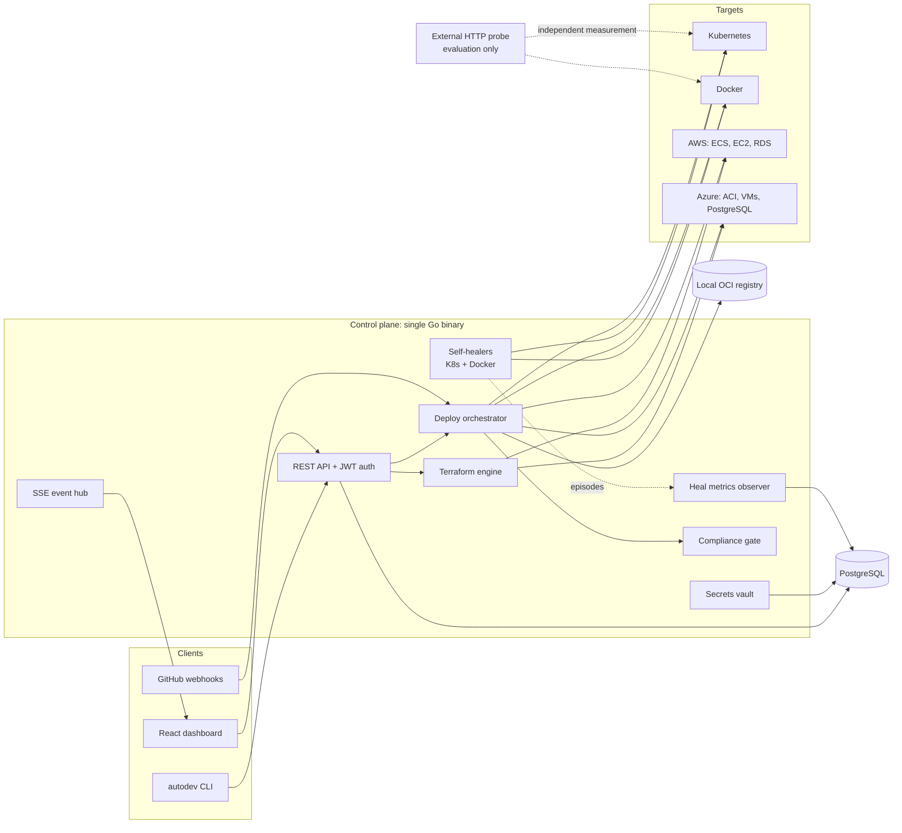

# AutoDevOps

A self-hostable control plane that provisions, deploys and self-heals applications across AWS, Azure, Kubernetes and Docker from a single Go binary, with a React dashboard, REST API and CLI.

Built as my MSc major project at Nottingham Trent University (2026), and used as the testbed for an empirical study of how far a self-healing platform's own recovery metrics can be trusted.

[](https://doi.org/10.5281/zenodo.21907439)

---

## Research finding

Self-healing platforms report their own recovery: time to detect, time to recover, availability. The question this project asked is whether those numbers can be believed.

Across **250 injected failures** in three conditions, every recovery episode was recorded twice and independently: once by the platform's own metrics observer, and once by an external HTTP probe with no connection to the platform.

| | Result |
|---|---|
| Correlation between self-reported recovery and externally probed availability | None (uncorrelated) |
| Polling-based monitoring | Self-reports **overstated** availability by a factor of **2.68** |
| Event-driven monitoring | Self-reports **understated** availability |

**Takeaway:** a system that both performs and reports its own healing cannot be used to validate itself. Self-reported recovery should not be treated as evidence of reliability without external measurement.

- Paper: Ezziane, Z. and Kdimati, M. E. (2026). *AutoDevOps: Design and Empirical Evaluation of a Self-Hostable, Deterministic Control Plane for Unified Multi-Cloud DevOps.* Under review at Results in Engineering (Elsevier).
- Data, analysis scripts and competitor configurations: [doi.org/10.5281/zenodo.21907439](https://doi.org/10.5281/zenodo.21907439). This includes 110 local deployment trials, 26 on Azure Container Instances, 26 on an Azure VM, Terraform provisioning timings, and a capability comparison against four self-hostable alternatives.

---

## What it does

A developer connects a Git repository, picks a target, and gets a running, TLS-secured deployment with generated CI/CD, without writing manifests.

- **Deploy targets:** local Docker and Docker Compose, Kubernetes (kind), AWS ECS, Azure Container Instances, and AWS EC2 or Azure VMs over SSH.
- **Infrastructure as code:** parameterised Terraform templates for AWS and Azure (networking, compute, container services, registries, managed PostgreSQL), executed through `terraform-exec` and covered by golden-file tests.
- **Self-healing:** health watchers for Kubernetes and Docker workloads restart failed targets, and a separate observer records each episode (detected, recovered, gave up) for MTTD/MTTR reporting without influencing healing decisions.
- **Git to deploy:** GitHub webhooks trigger builds with Cloud Native Buildpacks, push to a local OCI registry, and roll out. Per-framework GitHub Actions workflows can be generated and installed into the repo.
- **Compliance gate:** scans the repository, container images and IaC with Hadolint, Trivy, tfsec and Gitleaks before deploying.
- **Secrets:** built-in vault with AES-256-GCM envelope encryption, an argon2id-derived master key, and key rotation.
- **Live state:** polls AWS and Azure for real resource status, streams events to the dashboard over Server-Sent Events, and includes a browser terminal for connected VMs.
- **TLS:** automatic Let's Encrypt certificates for deployed apps, issued with certbot behind an nginx reverse proxy after a DNS check.

---

## Architecture



The external probe is not part of the platform. It sits outside the control plane so that availability can be measured independently of what the platform reports.

---

## Stack

| Layer | Technology |
|---|---|
| Control plane | Go, chi, pgx, goose migrations, client-go, Docker SDK, AWS SDK v2, Azure SDK |
| IaC | Terraform via `terraform-exec`, embedded HCL templates |
| Builds | Cloud Native Buildpacks (`pack`) |
| Database | PostgreSQL |
| Frontend | React, TypeScript, Vite, Tailwind, TanStack Query, xterm.js |
| CLI | Go (Cobra) |
| CI | GitHub Actions: build, test (including `terraform validate` on generated HCL), vet |

---

## Repository layout

```
cmd/server      control plane entry point
cmd/cli         autodev CLI (see docs/cli.md)
internal/       api, deploy, terraform, k8s, docker, healmetrics, compliance,
                secrets, cloud, console, cicd, registry, sse, notify, ...
migrations/     PostgreSQL schema (goose)
web/            React dashboard
scripts/        kind cluster and local registry setup (bash and PowerShell)
deploy/         example nginx reverse proxy config
```

---

## Running locally

**Prerequisites:** Go (version in `go.mod`), Node.js 20+, Docker, PostgreSQL, [kind](https://kind.sigs.k8s.io/), Terraform.

```bash
# 1. Local Kubernetes cluster, ingress and image registry
./scripts/setup-kind.sh            # Windows: scripts\setup-kind.ps1

# 2. Database
createuser autodevops -P           # password: autodevops (dev only)
createdb -O autodevops autodevops

# 3. Control plane (runs migrations on start, listens on :8080)
cp .env.example .env               # set JWT_SECRET and MASTER_KEY
./run-dev.sh                       # Windows: run-dev.bat

# 4. Dashboard (http://localhost:5173)
cd web && npm install && npm run dev
```

Log in with the `ADMIN_EMAIL` and `ADMIN_PASSWORD` from your environment. **Change the defaults before exposing the server to any network.**

CLI:

```bash
go build -o autodev ./cmd/cli
autodev login --server http://localhost:8080 --email admin@autodevops.local
autodev deployments list
```

Full CLI reference: [docs/cli.md](docs/cli.md).

---

## Tests

```bash
go test ./...
AUTODEVOPS_TF_VALIDATE=1 go test ./internal/terraform/...   # also runs terraform validate on generated HCL
```

---

## Status

Research prototype. Single-tenant, with one admin account and no RBAC. It was built to be evaluated, not run in production.

## Citation

If you use the data, please cite:

> Kdimati, M. E. (2026). *Replication package: measurement data for a deterministic unified control plane for multi-cloud application deployment* (Version 1.0.0) [Dataset]. Zenodo. https://doi.org/10.5281/zenodo.21907439

## License

Apache License 2.0. See [LICENSE](LICENSE).

## Author

M.Eyad Kdimati, MSc Cloud and Enterprise Computing, Nottingham Trent University. Supervised by Dr Zoheir Ezziane.
[LinkedIn](https://www.linkedin.com/in/m-eyad-kdimati-509255305/)
